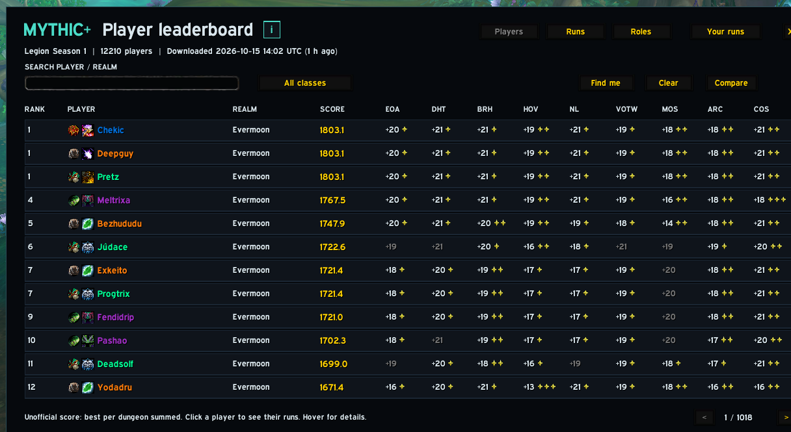
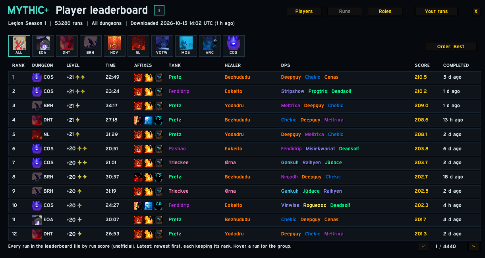
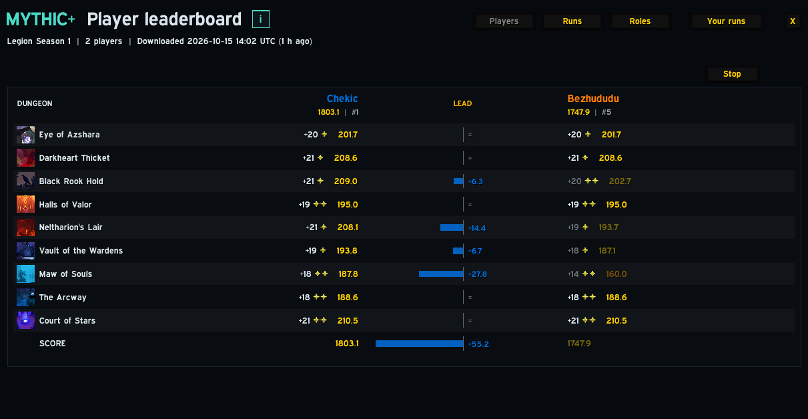
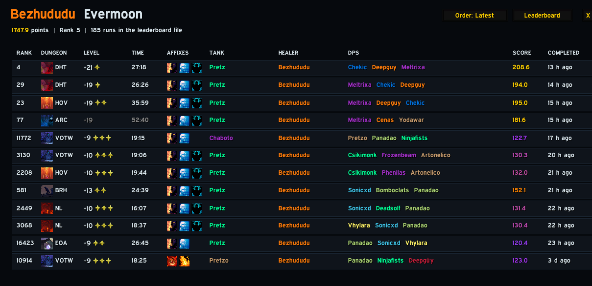
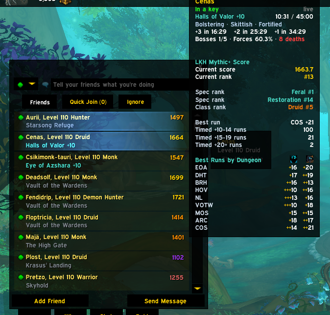

# Legion Key History

Raider.IO-style Mythic+ scores and leaderboards for **Legion (7.3.5) on Tauri** (Evermoon,
Tauri and Warriors of Darkness), right in the game, plus a journal of every key you run.

## ⬇️ [Download LegionKeyHistory.zip](https://github.com/bez-wow/legionkeyhistory/releases/latest/download/LegionKeyHistory.zip)

## Install

1. **Extract** the zip into `World of Warcraft\Interface\AddOns\`.
2. **Open** `Interface\AddOns\LegionKeyHistory\LKH Updater.cmd` and **press 2**.

That's it. The leaderboard now updates every hour in the background, and new addon versions
install by themselves (only while WoW is closed). The first time you log in, a short setup walks
you through the options with live previews, and your keys already on the leaderboard are added
to your journal.

> Use the download link above, not GitHub's green "Code" button: that zip has the wrong folder name.
> On Mac or Linux, see [below](#mac-and-linux).

## Screenshots

| Every run, by score | Compare players |
|---|---|
|  |  |
| **A player's runs** | **Friends list and tooltips** |
|  |  |

## What it does

- **Scores on players:** in the friends list, the group finder and player tooltips, with their
  overall, spec and class rank and best key per dungeon.
- **Leaderboard** (`/lkh lb`): players, every run, and Tank / Healer / DPS ladders. Filter by
  class and spec, click a player for all their runs, or compare up to five side by side.
- **Friends in keys:** friends and guildmates who also use LKH show their key live ("Maw of Souls +11"), with
  timer, bosses, forces and deaths in the tooltip.
- **Party keys:** inside a dungeon, a small window shows each group member's keystone, with
  keys for that dungeon on top. Drag it, then click the lock (`/lkh keys` to move it again).
- **Your group** (`/lkh party`): everyone's score and best keys side by side.
- **Journal** (`/lkh`): every key you finish, with your group, affixes and time, and stats on
  your favourite dungeons and the people you play with.
- **Talents in every key:** when a key starts, LKH saves each group member's spec and talents
  (group members with LKH send theirs; the others are inspected). The updater shares your finished
  keys with [Keystone Tauri](https://keystone-tauri.vercel.app), which checks them against the Tauri
  leaderboard, and [the website](https://tauriachievements.github.io/mythic-plus) shows the talents
  in each run's details. To stop sharing, run `LKH Updater.cmd` and press **6**.

Scores are unofficial: the sum of each character's best run per dungeon, with the
[Tauri Achievements](https://tauriachievements.github.io/mythic-plus/scoring) formula. The same
leaderboard is on [the website](https://tauriachievements.github.io/mythic-plus?view=players).

## Commands

| Command | Opens |
|---|---|
| `/lkh` | your journal |
| `/lkh lb` | the leaderboard |
| `/lkh party` | your group |
| `/lkh keys` | move the party keys window (`/lkh keystest` to preview it) |
| `/lkh config` | settings |
| `/lkh setup` | the setup again |

## Mac and Linux

WoW in CrossOver, Whisky, Wine, Lutris, Bottles or Steam. Open a terminal, type `bash ` (with a
space), drag `LKH-Updater.sh` from the addon folder into the window, press Enter, then **press 2**.

It is the same menu as on Windows. The hourly update runs as a launchd agent on Mac, and as a
systemd user timer (or cron) on Linux. Linux needs `curl` or `wget` and `unzip`, which most
distributions have; a Mac has everything already.

## Updating by hand

Run the updater again: **3** installs the newest addon, **4** the newest leaderboard, **5** turns
the hourly update off. In WoW, `/reload` loads a new leaderboard; a new addon version needs a
restart.
